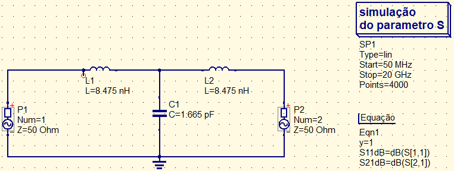
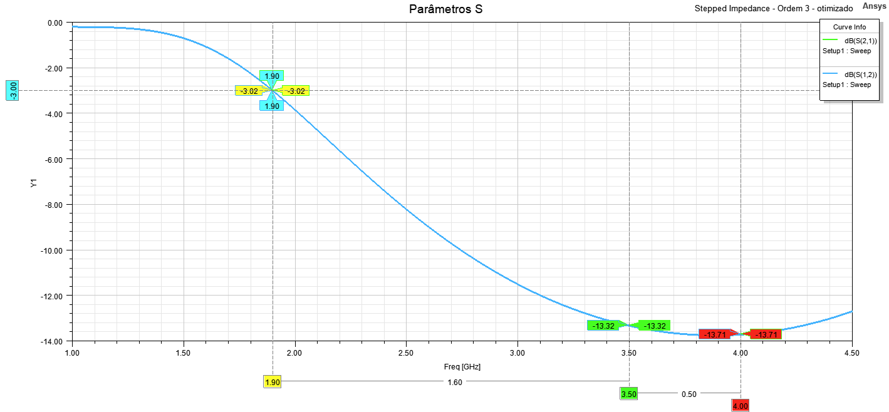
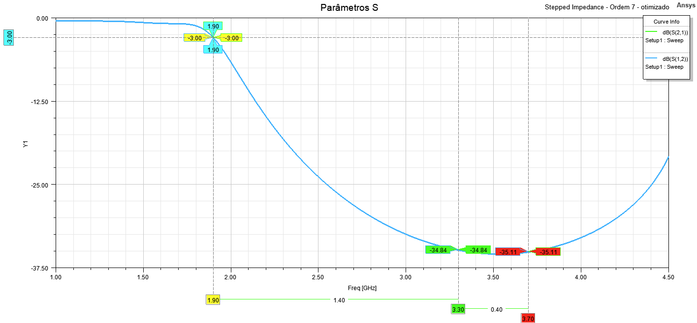

# Microstrip Low-Pass Filters

Experiment 3 of the *Microwave Devices* (Dispositivos de Micro-ondas) course of the Telecommunications Engineering program at the Federal University of Santa Maria (UFSM), taught by Prof. Candice Müller.

A Chebyshev low-pass filter (fc = 1.9 GHz, 1 dB ripple, Z0 = 50 Ω) is designed and implemented in four ways: lumped elements, shunt stubs obtained with the Richards transform and Kuroda identities, and stepped impedance of orders 3 and 7. The microstrip versions are simulated in Ansys HFSS, optimized and compared.

<p align="center">
  
</p>

<p align="center"><em>HFSS model of the stub filter obtained with the Richards transform and Kuroda identities.</em></p>

## What this project covers

1. **Lumped-element prototype** from the normalized Chebyshev coefficients, simulated in Qucs.
2. **Richards transform** to turn the inductors and the capacitor into transmission-line stubs.
3. **Kuroda identities** with unit elements to convert the series stubs into shunt stubs that can be built in microstrip.
4. **Stepped-impedance filters** of orders 3 and 7, with high-impedance (Zh) and low-impedance (Zl) sections.
5. **Microstrip synthesis** of widths and lengths on FR-4, computed in MATLAB.
6. **HFSS optimization** with one length-scaling variable per filter, to place the −3 dB point at 1.9 GHz.
7. **Comparison** of passband, transition band and stopband between the implementations.

## Specifications

| Parameter | Value |
|---|---|
| Response | Chebyshev, 1 dB ripple |
| Cutoff frequency | 1.9 GHz |
| Port impedance | 50 Ω |
| High / low impedance (stepped impedance) | Zh = 110 Ω, Zl = 22 Ω |
| Substrate | FR-4, εr = 4.4, h = 1.6 mm |

## Lumped-element prototype

With g1 = g3 = 2.0236 and g2 = 0.9941, impedance and frequency scaling give a series-L, shunt-C, series-L ladder with **L1 = L3 = 8.475 nH** and **C2 = 1.665 pF**.

<p align="center">
  
</p>

<p align="center">
  
</p>

The response has the expected 1 dB ripple up to 1.9 GHz, but the roll-off is slow: the transition band reaches 18.1 GHz.

## Stub filter: Richards transform and Kuroda identities

The Richards transform maps each inductor to a series short-circuited stub and the capacitor to a shunt open-circuited stub, all λg/8 long at fc. Unit elements are added at both ends, and the Kuroda identity (n² = 1 + Z2/Z1 = 1.494) moves the series stubs to shunt stubs.

| Impedance | 50 Ω | 50.3 Ω | 74.7 Ω | 151.18 Ω |
|---|---|---|---|---|
| Width | 3.06 mm | 3.03 mm | 1.444 mm | 0.174 mm |
| Length (λg/8) | 10.815 mm | 10.82 mm | 11.12 mm | 11.67 mm |
| Optimized length (× 1.205) | 13.032 mm | 13.038 mm | 13.400 mm | 14.062 mm |

The first simulation had the −3 dB point below the design frequency, so every length was multiplied by a variable p, set to 1.205 after optimization.

<p align="center">
  
</p>

The optimized filter keeps the 1 dB ripple, has −3 dB at 1.9 GHz and a **transition band of 980 MHz**. The stopband is only 70 MHz wide, because the response repeats above about 2.95 GHz: the Richards transform makes the response periodic in frequency.

## Stepped-impedance filter, order 3

High-impedance sections (110 Ω) act as series inductors and low-impedance sections (22 Ω) as shunt capacitors. Their lengths are l = gk·R0 / (Zh·β) and l = gk·Zl / (R0·β).

| Section | Z0 | Width | Length | Optimized length (× 0.944) |
|---|---|---|---|---|
| 1 | 110 Ω | 0.538 mm | 13.389 mm | 12.639 mm |
| 2 | 22 Ω | 10.558 mm | 5.705 mm | 5.386 mm |
| 3 | 110 Ω | 0.538 mm | 13.389 mm | 12.639 mm |

<p align="center">
  
</p>

<p align="center">
  
</p>

After optimization the filter has the 1 dB ripple, a **transition band of 1.6 GHz** and a stopband of 500 MHz.

## Stepped-impedance filter, order 7

The same technique with the 7th-order coefficients (2.1664, 1.1116, 3.0934, 1.1736, 3.0934, 1.1116, 2.1664), optimized with p = 0.807.

| Section | 1 | 2 | 3 | 4 | 5 | 6 | 7 |
|---|---|---|---|---|---|---|---|
| Z0 | 110 Ω | 22 Ω | 110 Ω | 22 Ω | 110 Ω | 22 Ω | 110 Ω |
| Width (mm) | 0.538 | 10.558 | 0.538 | 10.558 | 0.538 | 10.558 | 0.538 |
| Optimized length (mm) | 11.567 | 5.148 | 16.517 | 5.435 | 16.517 | 5.148 | 11.567 |

<p align="center">
  
</p>

<p align="center">
  
</p>

The 7th-order filter has a **transition band of 1.4 GHz** and a stopband of 400 MHz.

## Comparison

| Implementation | Simulator | Cutoff (−3 dB) | Transition band |
|---|---|---|---|
| Lumped elements, order 3 | Qucs | 1.9 GHz | 18.1 GHz |
| Richards + Kuroda stubs, order 3 | HFSS | 1.9 GHz | 980 MHz |
| Stepped impedance, order 3 | HFSS | 1.9 GHz | 1.6 GHz |
| Stepped impedance, order 7 | HFSS | 1.9 GHz | 1.4 GHz |

All four filters keep the 1 dB ripple in the passband. The stub filter has the steepest roll-off, with a transition band about 20 times narrower than the lumped prototype, at the cost of a periodic response at higher frequencies. The stepped-impedance filter has the simplest layout, but it needs a higher order to compete in selectivity: going from order 3 to order 7 narrowed the transition band from 1.6 GHz to 1.4 GHz. In every microstrip design, the analytical lengths placed the −3 dB point slightly off 1.9 GHz, and a single length-scaling variable in HFSS was enough to correct it.

The full report, with the calculations, the HFSS models and all the S-parameter curves, is in [`results/microstrip_lowpass_filters_report.pdf`](results/microstrip_lowpass_filters_report.pdf) (in Portuguese).

## MATLAB script

[`src/lowpass_filter_design.m`](src/lowpass_filter_design.m) computes the lumped values, the Kuroda impedances and all the microstrip widths and lengths, before and after optimization.

The script picks the Hammerstad formula for w/h ≤ 2 or w/h > 2 automatically. For the 22 Ω line, w/h is about 6, so the wide-strip formula gives a width of 9.86 mm. The report and the HFSS models used 10.56 mm, from the narrow-strip formula. The small difference in width was absorbed by the length optimization in HFSS.

## Repository contents

```
Microstrip low-pass filters/
├── README.md
├── src/
│   └── lowpass_filter_design.m
└── results/
    ├── microstrip_lowpass_filters_report.pdf
    ├── 01_lumped_qucs_schematic.png
    ├── 02_lumped_qucs_S21.png
    ├── 03_richards_kuroda_hfss_model.png
    ├── 04_richards_kuroda_S21_optimized.png
    ├── 05_stepped_impedance_N3_hfss_model.png
    ├── 06_stepped_impedance_N3_S21_optimized.png
    ├── 07_stepped_impedance_N7_hfss_model.png
    └── 08_stepped_impedance_N7_S21_optimized.png
```

The Ansys HFSS project files are not included. The report documents the model setup and the results.

## Tools

- Ansys HFSS (3D electromagnetic simulation)
- Qucs (lumped-element circuit simulation)
- MATLAB (microstrip width and length calculations)

## References

1. POZAR, D. M. *Microwave Engineering*. John Wiley, 2005.
2. MÜLLER, C. *Dispositivos de Micro-ondas*, Chapter 5: Filters. Course notes, UFSM, 2024.
