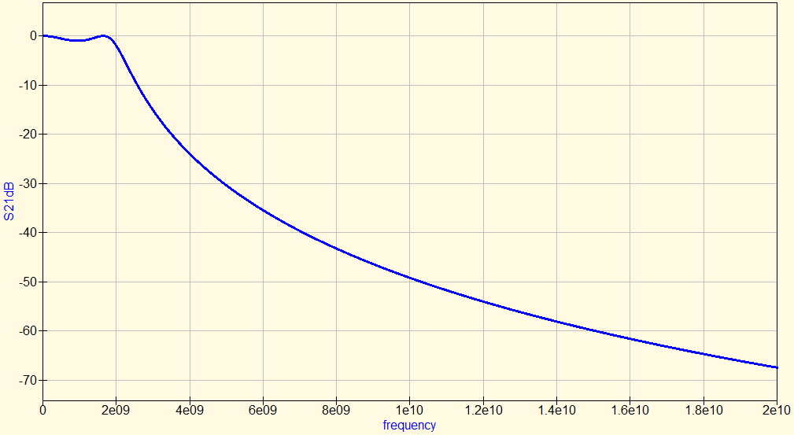
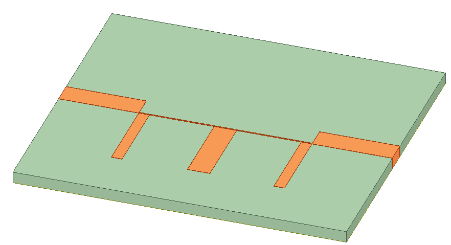
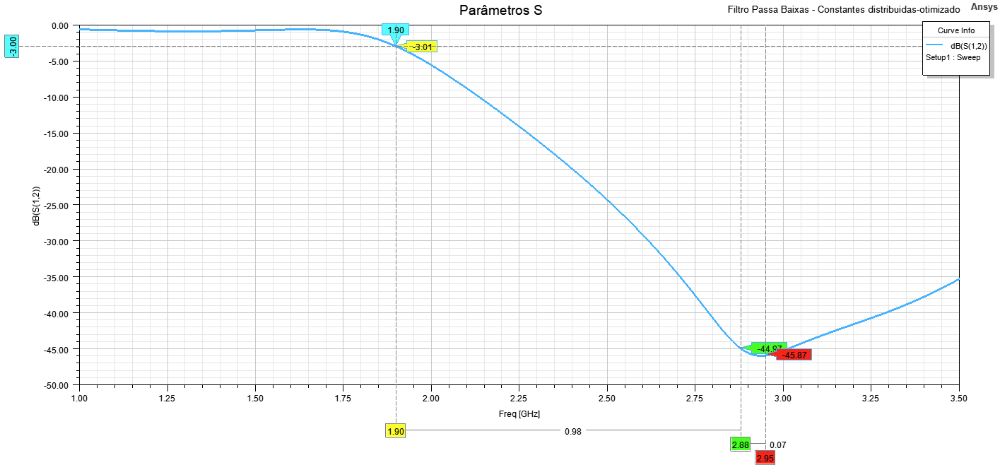
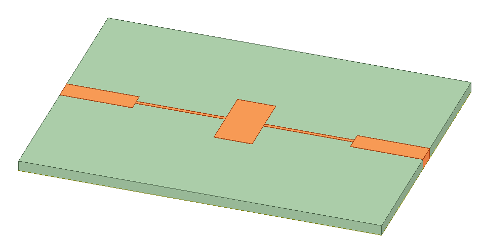
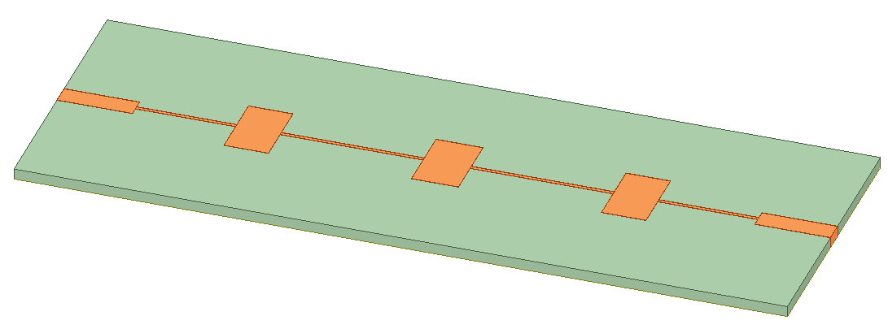

# Microstrip low-pass filters

Design, simulation and optimization of a **3rd-order Chebyshev low-pass filter** (fc = 1.9 GHz, 1 dB ripple, Z0 = 50 Ω) implemented in three ways: lumped elements, distributed elements (Richards transform + Kuroda identities) and stepped impedance (orders 3 and 7). Microstrip designs are on **FR-4 (h = 1.6 mm)** and were simulated in **Ansys HFSS**; the lumped-element prototype was simulated in **Qucs**.

## Specifications

| Parameter | Value |
|---|---|
| Response | Chebyshev, 1 dB ripple |
| Cutoff frequency fc | 1.9 GHz |
| Characteristic impedance Z0 | 50 Ω |
| Low impedance Zl (stepped impedance) | 22 Ω |
| High impedance Zh (stepped impedance) | 110 Ω |
| Substrate | FR-4, h = 1.6 mm |

## 1. Lumped-element prototype (Qucs)

The normalized Chebyshev coefficients (g1 = g3 = 2.0236, g2 = 0.9941) were scaled in impedance and frequency, giving a series-L / shunt-C / series-L ladder:

- L1 = L3 = **8.475 nH**
- C2 = **1.665 pF**




The response is a correct low-pass with 1 dB ripple, but the transition band is very wide — only a higher order (or a distributed implementation) makes it steeper.

## 2. Distributed elements: Richards transform + Kuroda identities

- **Richards transform:** inductors → series short-circuited stubs, capacitor → shunt open-circuited stub (λ/8 at fc).
- **Unit elements** added at both ends, then the **Kuroda identity** (n² = 1 + Z2/Z1 = 1.494) converts series stubs into shunt stubs, which are realizable in microstrip.
- Widths and lengths computed with the microstrip synthesis equations (Hammerstad) for FR-4.

| Impedance | 50 Ω | 50.3 Ω | 74.7 Ω | 151.18 Ω |
|---|---|---|---|---|
| W (mm) | 3.06 | 3.03 | 1.444 | 0.174 |
| L (mm), designed | 10.815 | 10.82 | 11.12 | 11.67 |
| L (mm), optimized (×1.205) | 13.032 | 13.038 | 13.400 | 14.062 |

The first HFSS simulation placed the −3 dB point off fc, so all lengths were scaled by a single variable **p = 1.205** to center −3 dB at 1.9 GHz.




Result: 1 dB ripple in the passband, **transition band ≈ 980 MHz**. The stopband is narrow (≈ 70 MHz) because the response repeats beyond ~2.95 GHz — a consequence of the periodic nature of the Richards transform.

## 3. Stepped-impedance filter — order 3

High-impedance sections (Zh = 110 Ω) act as series inductors and low-impedance sections (Zl = 22 Ω) as shunt capacitors, with lengths l = gk·R0 / (Zh·β) and l = gk·Zl / (R0·β).

| Section | Z0 (Ω) | εeff | W (mm) | L (mm), designed | L (mm), optimized (×0.944) |
|---|---|---|---|---|---|
| 1 | 110 | 2.98 | 0.538 | 13.389 | 12.639 |
| 2 | 22 | 3.71 | 10.558 | 5.705 | 5.386 |
| 3 | 110 | 2.98 | 0.538 | 13.389 | 12.639 |




Result: 1 dB ripple, **transition band ≈ 1.6 GHz**, stopband ≈ 500 MHz.

## 4. Stepped-impedance filter — order 7

Same technique with the 7th-order Chebyshev coefficients (g = 2.1664, 1.1116, 3.0934, 1.1736, …), optimized with **p = 0.807**.

| Section | 1 | 2 | 3 | 4 | 5 | 6 | 7 |
|---|---|---|---|---|---|---|---|
| Z0 (Ω) | 110 | 22 | 110 | 22 | 110 | 22 | 110 |
| W (mm) | 0.538 | 10.558 | 0.538 | 10.558 | 0.538 | 10.558 | 0.538 |
| L (mm), optimized | 11.567 | 5.148 | 16.517 | 5.435 | 16.517 | 5.148 | 11.567 |




Result: 1 dB ripple, **transition band ≈ 1.4 GHz**, stopband ≈ 400 MHz.

## Comparison

| Implementation | Tool | Passband | Transition band |
|---|---|---|---|
| Lumped elements (N = 3) | Qucs | 1.9 GHz | 18.1 GHz |
| Richards + Kuroda stubs (N = 3) | HFSS | 1.9 GHz | **980 MHz** |
| Stepped impedance (N = 3) | HFSS | 1.9 GHz | 1.6 GHz |
| Stepped impedance (N = 7) | HFSS | 1.9 GHz | 1.4 GHz |

**Takeaways**

- The distributed (Richards/Kuroda) filter gave the steepest roll-off — about 20× narrower transition band than the lumped prototype — at the cost of a periodic response at higher frequencies.
- Stepped impedance is the simplest layout to fabricate, but needs a higher order to compete in selectivity: going from N = 3 to N = 7 narrowed the transition band from 1.6 GHz to 1.4 GHz.
- Analytical microstrip equations do not land exactly on fc in full-wave simulation; a single length-scaling variable in HFSS was enough to center the −3 dB point in every design.

## Files

```
results/
├── microstrip_lowpass_filters_report.pdf   # full report (Portuguese)
├── 01_lumped_qucs_schematic.png
├── 02_lumped_qucs_S21.png
├── 03_richards_kuroda_hfss_model.png
├── 04_richards_kuroda_S21_optimized.png
├── 05_stepped_impedance_N3_hfss_model.png
├── 06_stepped_impedance_N3_S21_optimized.png
├── 07_stepped_impedance_N7_hfss_model.png
└── 08_stepped_impedance_N7_S21_optimized.png
```

The Ansys HFSS project files are not included.

## Reference

C. Müller, *Microwave Devices* course notes – Chapter 5: Filters, UFSM, 2024.
