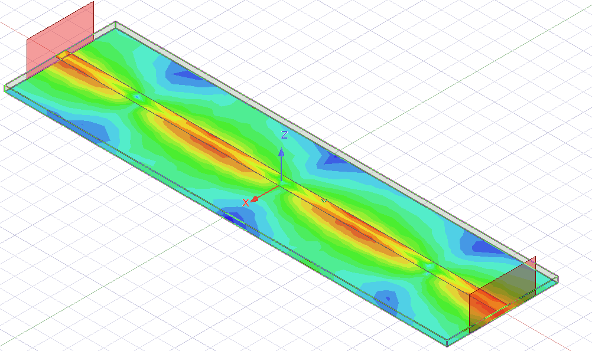
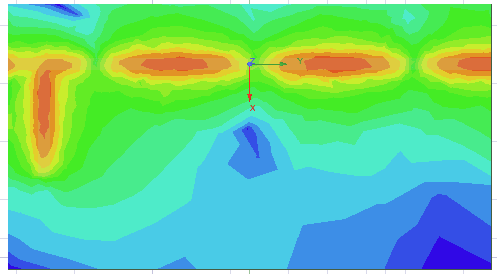
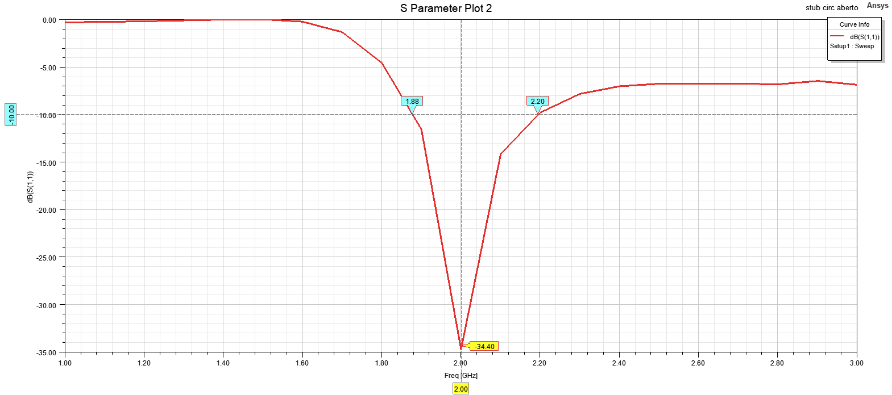
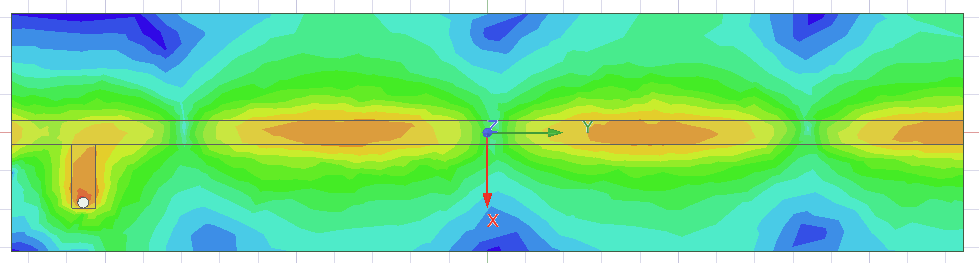
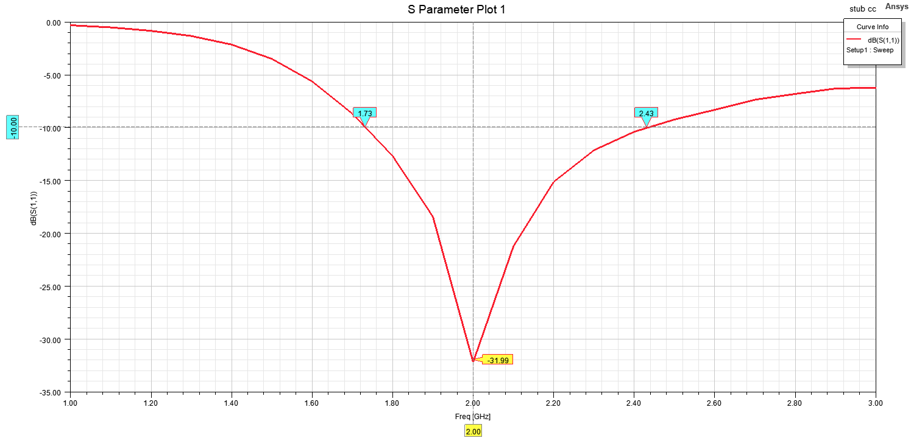

# Microstrip Transmission Line and Stub Matching

Homework 1 of the *Microwave Devices* (Dispositivos de Micro-ondas) course of the Telecommunications Engineering program at the Federal University of Santa Maria (UFSM), taught by Prof. Candice Müller.

The line is designed with analytical formulas and MATLAB, simulated in Ansys HFSS, and then used to study impedance matching with a single parallel stub.

## What this project covers

1. **50 Ω microstrip line on FR-4**: width and length calculation, two wave ports, field propagation, port reference impedance and S-parameters.
2. **Dielectric losses**: the same line with a lossy FR-4, compared with the lossless case.
3. **Load termination**: the second port is replaced by a lumped load (50 Ω, 100 Ω and a complex load of 60 − j80 Ω), and the simulated reflection coefficient is compared with theory.
4. **Open-circuit stub matching**: design of a parallel stub on the Smith chart to match the complex load, then simulation of the matched circuit.
5. **Short-circuit stub matching**: same design with a shorted stub, compared with the open-circuit one.

## Specifications

| Parameter | Value |
|---|---|
| Center frequency | 2 GHz |
| Analysis band | 1 GHz to 3 GHz |
| Substrate | FR-4 (lossless and lossy), εr = 4.3 |
| Substrate thickness | 1.6 mm |
| Conductor | PEC, 35 µm thick |

## Line design

| Quantity | Value |
|---|---|
| Line width, w | 3.12 mm (w/h ≈ 1.95) |
| Effective permittivity | 3.26 |
| Guided wavelength, λg | 83 mm |
| Line length | 124.5 mm (1.5 λg) |

<p align="center">
  
</p>

## Results

| Case | Result at 2 GHz |
|---|---|
| Lossless FR-4, two ports | S21 ≈ 0 dB, S11 and S22 ≈ −41 dB |
| Lossy FR-4, two ports | S21 ≈ −0.75 dB, S11 and S22 ≈ −40 dB |
| 50 Ω load | S11 = −28 dB |
| 100 Ω load | S11 ≈ −11 dB (theory: |Γ| = 0.333, −9.54 dB) |
| 60 − j80 Ω load (60 Ω in series with about 1 pF) | S11 = −4.6 dB (theory: −4.54 dB) |
| Complex load with open-circuit stub | S11 = −34.4 dB, −10 dB bandwidth of 320 MHz (1.88 GHz to 2.20 GHz) |
| Complex load with short-circuit stub | S11 = −32 dB, −10 dB bandwidth of 700 MHz (1.73 GHz to 2.43 GHz) |

### Stub design

Read from the Smith chart, with the stub placed at a distance d from the load:

| Parameter | Electrical length | Physical length |
|---|---|---|
| Distance from load to stub, d | 0.113 λg | 9.38 mm |
| Open-circuit stub | 0.344 λg | 28.55 mm |
| Short-circuit stub | 0.094 λg | 7.8 mm |

### Matching network and fields (open-circuit stub)

<p align="center">
  
</p>

### S11 with the open-circuit stub

<p align="center">
  
</p>

### Matching network and fields (short-circuit stub)

<p align="center">
  
</p>

### S11 with the short-circuit stub

<p align="center">
  
</p>

Both stubs bring S11 well below −30 dB at 2 GHz. The short-circuit stub gives a wider −10 dB bandwidth (700 MHz against 320 MHz), which makes it the better option when the circuit has to work over a range of frequencies around the center.

The full report, with the calculations, field animations, Smith chart plots and the analysis of each item, is in [`results/report.pdf`](results/report.pdf).

## Repository contents

```
Microstrip Transmission Line and Stub Matching/
├── README.md
└── results/
    ├── homework_1_report.pdf
    ├── open_stub_layout_fields.png
    ├── s11_open_stub.png
    └── s11_short_stub.png
```

The Ansys HFSS project files are not included. The report documents the model setup, the materials and the results.

## Tools

- Ansys HFSS (3D electromagnetic simulation)
- MATLAB (line width and length calculation)

## References

1. POZAR, D. M. *Microwave Engineering*. John Wiley, 2005.
2. MÜLLER, C. *Microstrip*. Lecture notes, Microwave Devices, UFSM, 2024.
