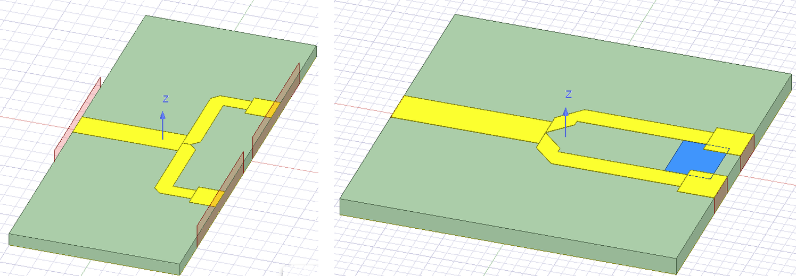
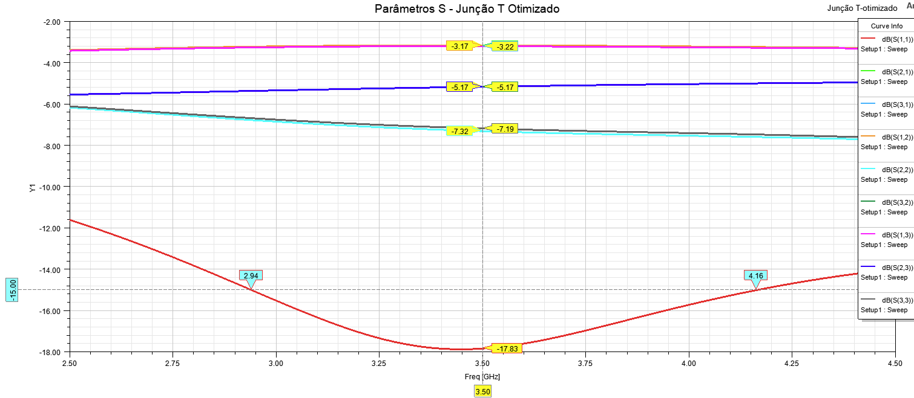
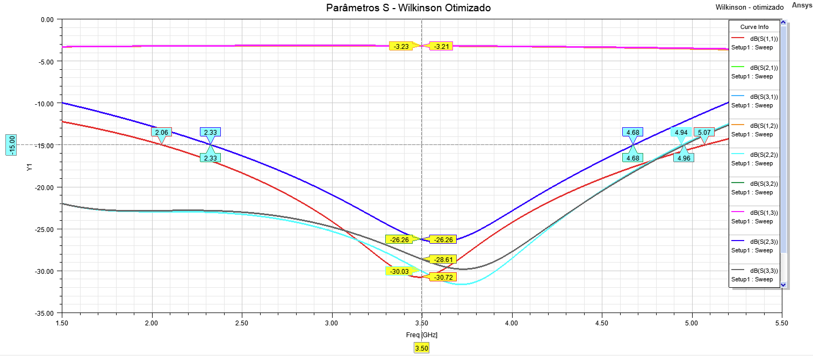
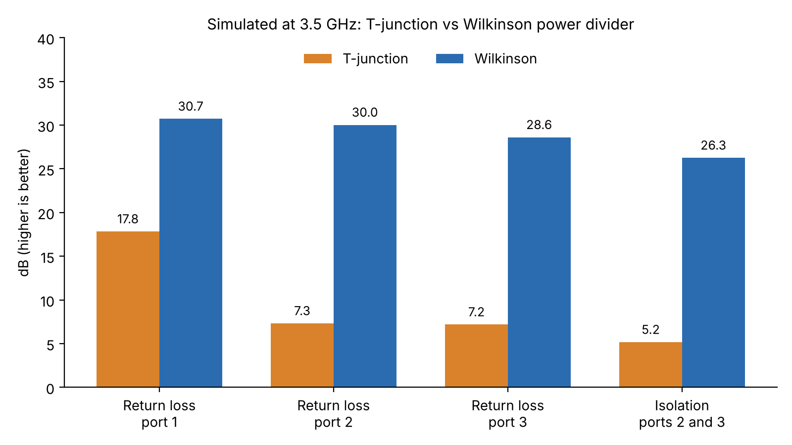

# T-junction and Wilkinson Power Dividers

Experiment 2 of the *Microwave Devices* (Dispositivos de Micro-ondas) course of the Telecommunications Engineering program at the Federal University of Santa Maria (UFSM), taught by Prof. Candice Müller.

Two three-port microstrip power dividers are designed for 3.5 GHz, simulated in Ansys HFSS, optimized and compared: a T-junction divider with a quarter-wave matching network, and a Wilkinson divider.

<p align="center">
  
</p>

<p align="center"><em>HFSS models of the optimized T-junction divider (left) and Wilkinson divider (right).</em></p>

## What this project covers

1. **Analytical S-matrix** of the T-junction divider from the port impedances.
2. **Line design** for 50 Ω and 70.7 Ω on Rogers RO4003: widths and quarter-wave lengths.
3. **HFSS model** with wave ports sized for the line, and a 2.5 GHz to 4.5 GHz sweep.
4. **Optimization** with chamfers at the 90° bends and at the junction, and small changes to the line lengths.
5. **Comparison** between analytical and simulated S-parameters.
6. **Analysis** of reflection, insertion loss, isolation, VSWR, bandwidth and reciprocity, plus the electric field with each port excited.
7. **Wilkinson divider** with a 100 Ω isolation resistor, and a comparison with the T-junction.

## Specifications

| Parameter | Value |
|---|---|
| Operating frequency | 3.5 GHz |
| Sweep | 2.5 GHz to 4.5 GHz |
| Substrate | Rogers RO4003, εr = 3.55, h = 1.56 mm |
| Conductor | PEC, 0.035 mm thick |
| Port impedance | 50 Ω |

## Line design

| Line | Width | Effective permittivity | Length (λg/4) |
|---|---|---|---|
| 50 Ω | 3.49 mm | 2.78 | 12.85 mm |
| 70.7 Ω (50√2 Ω) | 1.90 mm | 2.66 | 13.13 mm |

The wave ports are 17 mm wide and 3 mm high.

## T-junction divider

The analytical S-matrix gives S11 = −15.31 dB at the input, S21 = S31 = −3.14 dB and S23 = −4.64 dB between the outputs. The initial simulation had its S11 minimum above the design frequency, so the 70.7 Ω branches were lengthened to λg/3.3 (about 15.9 mm), the split between the two sections of the branch was changed from 80/20 to 70/30, and 0.9 mm chamfers were added at the line ends and at the junction.

| Parameter | Analytical | Simulated |
|---|---|---|
| S11 | −15.31 dB | −17.83 dB |
| S22 | −7.65 dB | −7.32 dB |
| S33 | −7.65 dB | −7.19 dB |
| S12 = S21 | −3.14 dB | −3.17 dB |
| S13 = S31 | −3.14 dB | −3.22 dB |
| S23 = S32 | −4.64 dB | −5.17 dB |

The input is well matched, and the bandwidth for S11 below −15 dB is 1.22 GHz (2.94 GHz to 4.16 GHz). The outputs are poorly matched and poorly isolated, as the analytical result predicts. With port 2 excited, about 48% of the power goes to port 1, 30% to port 3 and 18.5% is reflected. The simulated S-parameters are symmetric (S12 = S21, S13 = S31, S23 = S32), so the network is reciprocal.

<p align="center">
  
</p>

## Wilkinson divider

A 100 Ω lumped resistor between the two 70.7 Ω branches isolates the outputs. Lumped ports replaced the wave ports during optimization, because the wave port widths were too restrictive. The model was optimized with chamfers at the junction and at the line ends, adjustments to the 70.7 Ω line length and a new split between the two sections.

| Parameter | Ideal | Simulated |
|---|---|---|
| S11 | −∞ dB | −30.72 dB |
| S22 | −∞ dB | −30.03 dB |
| S33 | −∞ dB | −28.61 dB |
| S12 = S21 and S13 = S31 | −3 dB | about −3.2 dB |
| S23 = S32 | −∞ dB | −26.26 dB |

<p align="center">
  
</p>

## Comparison

Simulated values at 3.5 GHz. Return loss and isolation are shown as positive dB values, that is, the negative of S11, S22, S33 and S23.

| | T-junction | Wilkinson |
|---|---|---|
| Return loss, port 1 | 17.83 dB | 30.72 dB |
| Return loss, port 2 | 7.32 dB | 30.03 dB |
| Return loss, port 3 | 7.19 dB | 28.61 dB |
| Insertion loss, ports 1 and 2 | 3.17 dB | about 3.2 dB |
| Insertion loss, ports 1 and 3 | 3.22 dB | about 3.2 dB |
| Isolation, ports 2 and 3 | 5.17 dB | 26.26 dB |

<p align="center">
  
</p>

Both dividers split the power equally, with an insertion loss close to the ideal 3.01 dB. The difference is in matching and isolation. The T-junction is simple, but its outputs reflect part of the signal and leak about 30% of the power to each other. The Wilkinson divider adds one resistor and brings the output-to-output leakage down to about 0.2% (26 dB of isolation) and the return loss above 28 dB at all ports.

The full report, with the calculations, the HFSS setup, the electric field for each excited port and the VSWR curves, is in [`results/report.pdf`](results/report.pdf).

## Repository contents

```
T-junction and Wilkinson power dividers/
├── README.md
└── results/
    ├── report.pdf
    ├── power_dividers_models.png
    ├── t_junction_s_parameters.png
    ├── wilkinson_s_parameters.png
    └── divider_comparison.png
```

The Ansys HFSS project files are not included. The report documents the model setup and the results.

## Tools

- Ansys HFSS (3D electromagnetic simulation)
- MATLAB (line width and length calculations)

## References

1. POZAR, D. M. *Microwave Engineering*. John Wiley, 2005.
2. EMTalk. [Wave port size calculator](https://www.emtalk.com/waveport_calc.htm).
